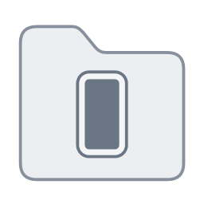

# Love My Shelf



파일 탐색기처럼 쓰면서, 영상과 사진, 짤에 내가 고른 표지를 붙여 큰 폴더를 한눈에 정리하는 Windows 프로그램입니다. 모든 파일이 큼직하게 보이고, 마음에 드는 장면은 **9:16 세로 표지**로 남겨 둘 수 있습니다.

**[Windows용 다운로드](https://github.com/LoveMyShelf/LoveMyShelf/releases/latest/download/LoveMyShelf-Windows.zip)** · [English](README.md) · [설명서](GUIDE.ko.md) · [변경 사항](CHANGELOG.md) · [모든 버전](https://github.com/LoveMyShelf/LoveMyShelf/releases)

## 만든 이유

다운로드 폴더나 짤 저장 폴더에 파일이 수천 개 쌓이면 원하는 파일을 찾기가 힘듭니다. 썸네일은 작고, 영상은 엉뚱한 첫 장면이 보여서 결국 하나씩 열어 보게 됩니다.

Love My Shelf는 익숙한 파일 탐색기 사용법은 그대로 두고, 파일 목록을 큰 썸네일로 바꿨습니다. 사진이나 영상의 원하는 장면을 표지로 저장하면 그 파일은 다음부터 표지로 보입니다.

원본 파일은 건드리지 않습니다. 표지는 항상 별도 파일로 저장됩니다.

## 시연 영상

**영상 하나로 표지 3개 만들기**: 영상에서 원하는 장면을 정확히 골라 JPG 표지 2개와 움직이는 GIF 표지 1개를 만듭니다. 목록에서 GIF 표지에 마우스를 올리면 바로 움직입니다.

https://github.com/user-attachments/assets/48bfd53c-b0b8-4434-aef3-d07efc0ed110

**표지는 파일을 따라다닙니다**: 영상을 다른 폴더로 끌어다 놓으면 움직이는 표지까지 모든 표지가 함께 옮겨집니다.

https://github.com/user-attachments/assets/8207c877-b828-43a1-bcfd-435b6c3d31c7

**파일 탐색기처럼 씁니다**: 폴더 나무, 주소창, 탐색기와 같은 폴더 보기, 마우스로 범위 선택, 복사와 붙여넣기를 그대로 쓸 수 있습니다.

https://github.com/user-attachments/assets/9d83da44-71f5-4ef2-a506-da4fc9b51617

## 기능

**파일 탐색기처럼 둘러보기**

- 왼쪽 폴더 나무에서 Love My Shelf에 추가한 폴더, 즐겨찾기, OneDrive, 내 PC, 네트워크를 열 수 있습니다.
- 주소창에서 경로를 누르거나 직접 입력할 수 있고, 뒤로·앞으로·위로·새로 고침을 지원합니다.
- 하위 폴더는 사진 위나 아래에 따로 모이고, 탐색기와 같은 8가지 보기로 바꿀 수 있습니다.
- 마우스로 끌어 범위를 선택하고, Ctrl+C·X·V로 복사하고 옮기고, 폴더나 창 사이로 끌어다 놓을 수 있습니다.
- 파일, 폴더, 빈 곳을 오른쪽 클릭하면 Windows 메뉴가 그대로 나옵니다.
- 창 두 개를 화면 반씩 나란히 놓고 정리하기 편합니다.

**큰 썸네일**

- 사진, 움직이는 GIF·WebP, 영상을 한 화면에서 보고 이름 검색, 정렬, 표지 유무 필터를 쓸 수 있습니다.
- 표지가 없는 파일은 Windows 썸네일을 그대로 써서, 파일이 많은 폴더도 빠르게 열립니다.
- 여러 폴더에 흩어진 표지를 표지 모음에서 한 번에 볼 수 있습니다.

**표지 만들기**

- 9:16 틀 안에서 휠로 확대하고 끌어서 위치를 맞춘 뒤 JPG로 저장합니다. 파일 하나에 표지를 여러 개 만들 수 있습니다.
- 영상은 멈춘 곳의 앞뒤 장면을 펼쳐 놓고 고릅니다. 장면 간격은 바꿀 수 있습니다(기본 0.2초).
- 움직이는 표지는 GIF, WebP, MP4로 저장합니다. 장면 띠에서 구간을 고르고 속도(0.5~2배)와 재생 방식을 정하면, 실제로 저장될 파일을 미리 볼 수 있습니다.
- 표지를 AI로 4배 선명하게 키울 수 있습니다(Swin2SR, ONNX Runtime). 결과는 원래 표지와 나란히 비교한 뒤 고릅니다.

**파일 관리**

- 이름 바꾸기(F2), 휴지통으로 보내기(Delete), 옮기기와 복사를 할 수 있습니다. 표지와 기록은 원본을 따라가고, 옮긴 것은 Ctrl+Z로 되돌립니다.
- 프로그램 밖에서 옮기거나 이름을 바꾼 파일도 Windows 파일 ID와 파일 내용으로 다시 찾아냅니다.
- 표지나 원본을 다른 프로그램으로 복사, 공유, 끌어다 놓을 수 있습니다. 파일을 Windows에 넘겨줄 뿐, 인터넷에 올리지는 않습니다.

**영상 재생**

- libmpv 하드웨어 가속으로 재생하고, 재생 바 미리보기, 한 장면씩 넘기기, 이동·속도·밝기·음량 단축키를 지원합니다.

밝은 테마와 어두운 테마, 한국어와 영어를 지원합니다.

지원하는 파일: JPG, PNG, BMP, TIFF, GIF, WebP, 그리고 FFmpeg·mpv로 열 수 있는 영상(MP4, MOV, MKV, WEBM, AVI 등)

## 필요한 환경

- Windows 10 또는 11 (64비트)
- .NET Framework 4.8 (Windows 10 1903 이후에는 기본으로 설치되어 있습니다)

## 설치

[다운로드 페이지](https://github.com/LoveMyShelf/LoveMyShelf/releases)에서 `LoveMyShelf-Windows.zip`을 받아 압축을 모두 풀고 `LoveMyShelf.exe`를 실행하면 됩니다. 따로 설치할 필요는 없습니다.

프로그램에 코드 서명이 없어서 처음 실행할 때 Windows 보안 경고(SmartScreen)가 뜰 수 있습니다. 이때는 **추가 정보** → **실행**을 누르세요. 다운로드 페이지에 ZIP 파일의 SHA-256 값을 적어 두었습니다.

새 버전이 나오면 새 ZIP을 기존 폴더에 덮어쓰면 됩니다. 삭제하려면 프로그램 폴더와 `%LOCALAPPDATA%\LoveMyShelf` 폴더를 지우면 됩니다.

## 소스에서 빌드하기

Windows에 기본으로 들어 있는 .NET Framework 4.8 C# 컴파일러로 빌드합니다. Visual Studio, SDK, NuGet은 필요 없습니다.

```powershell
.\build.ps1
```

`src/` 폴더의 `*.cs` 파일을 모두 컴파일해서 `build.ps1`과 같은 폴더에 `LoveMyShelf.exe`(WPF)를 만듭니다. 프로그램이 켜져 있어도 빌드할 수 있고, 새로 만든 파일은 다음 실행부터 적용됩니다.

저장소에는 소스 코드만 있습니다. 모든 기능을 쓰려면 아래 파일을 `LoveMyShelf.exe`와 같은 폴더에 넣어 주세요. 다운로드한 ZIP에서 복사하는 게 가장 간단합니다.

| 경로 | 용도 | 출처 |
| --- | --- | --- |
| `libmpv-2.dll` | 영상 재생 | [shinchiro/mpv-winbuild-cmake](https://github.com/shinchiro/mpv-winbuild-cmake) |
| `tools/ffmpeg.exe`, `tools/ffprobe.exe`, `tools/*.dll` | 장면 읽기, 움직이는 표지 저장 | [FFmpeg-Builds](https://github.com/FFmpeg-Builds/FFmpeg-Builds) (GPL shared) |
| `upscale/onnxruntime.dll`, `upscale/DirectML.dll`, `upscale/onnxruntime_providers_shared.dll` | AI로 키우기 | `onnxruntime-directml` 1.24.4 (PyPI) |
| `upscale/model.onnx` | AI로 키우기 모델 | [Xenova/swin2SR-realworld-sr-x4-64-bsrgan-psnr](https://huggingface.co/Xenova/swin2SR-realworld-sr-x4-64-bsrgan-psnr) |
| `fonts/` | 글꼴(Pretendard) | 이 저장소에 포함 |

이 파일들이 없어도 프로그램은 실행되고, 관련 기능만 쓸 수 없습니다. 정확한 버전은 [THIRD-PARTY-NOTICES.md](THIRD-PARTY-NOTICES.md)에 있습니다.

## 코드 구성

소스 코드는 모두 `src/` 폴더에 있습니다. 파일별 설명은 [영어 README의 Code layout](README.md#code-layout)을 참고하세요.

## 데이터와 인터넷 사용

- 추가한 폴더, 표지 위치, 설정 같은 기록은 `%LOCALAPPDATA%\LoveMyShelf` 폴더에 텍스트·XML 파일로 저장됩니다.
- 표지는 처음 실행할 때 고른 표지 폴더에 JPG로 저장됩니다. 설정에서 원본 옆에 저장하도록 바꿀 수도 있습니다.
- 인터넷은 새 버전 확인에만 씁니다. GitHub에 최신 버전 번호를 한 번 물어보는 것이 전부이고, 「설명서 겸 옵션」에서 끌 수 있습니다. 사용 기록은 수집하지 않습니다.

## 현재 상태와 문의

현재 버전은 1.0.4입니다. Windows 11에서만 개발하고 테스트했습니다. 버그 제보, 질문, 제안은 [Issues](https://github.com/LoveMyShelf/LoveMyShelf/issues)에 남겨 주세요. 메일: lovemyshelf.app@outlook.com

## 라이선스

Love My Shelf는 [GPL-3.0](LICENSE) 라이선스를 따릅니다. 함께 들어 있는 libmpv, FFmpeg, ONNX Runtime, Swin2SR, Pretendard는 각자의 라이선스를 따르며, 자세한 내용은 [THIRD-PARTY-NOTICES.md](THIRD-PARTY-NOTICES.md)에 있습니다.

시연 영상 속 강아지 영상은 Pexels의 [Nothing Ahead](https://www.pexels.com/video/11622180/) 님 영상이며, [Pexels 라이선스](https://www.pexels.com/license/)에 따라 사용했습니다.
