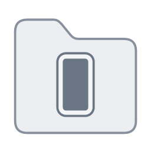

# Love My Shelf



A Windows app that works like File Explorer and lets you give your videos, photos, and memes the covers you choose, so huge messy folders are easy to scan. Everything appears as large tiles, and you can keep the moment you care about as a **9:16 cover**.

**[Download for Windows](https://github.com/LoveMyShelf/LoveMyShelf/releases/latest/download/LoveMyShelf-Windows.zip)** · [한국어](README.ko.md) · [User guide](GUIDE.md) · [Changelog](CHANGELOG.md) · [All releases](https://github.com/LoveMyShelf/LoveMyShelf/releases)

## Why

A downloads or meme folder with thousands of mixed files is hard to scan. Thumbnails are small, videos show whatever their first frame happens to be, and you end up opening files one by one.

Love My Shelf keeps the folder navigation you already know and replaces the file list with a large grid. Pick any photo or any moment in a video, save it as a cover, and that file is shown by its cover from then on.

Originals are never modified. A cover is always a separate file.

## Demo

**One video, three covers.** Pick exact frames from a video and save two JPG covers and one animated GIF cover. Point at the GIF cover in the grid and it plays.

https://github.com/user-attachments/assets/48bfd53c-b0b8-4434-aef3-d07efc0ed110

**Covers follow their file.** Drag a video to another folder and all of its covers go with it, including the animated one.

https://github.com/user-attachments/assets/8207c877-b828-43a1-bcfd-435b6c3d31c7

**Works like File Explorer.** Folder tree, address bar, Explorer's folder views, drag to select, copy and paste.

https://github.com/user-attachments/assets/9d83da44-71f5-4ef2-a506-da4fc9b51617

## Features

**Browse like File Explorer**

- Folder tree with your Love My Shelf folders, Quick access, OneDrive, This PC and network locations.
- Address bar with clickable path, typed paths and suggestions; back, forward, up and refresh.
- Subfolders in their own area, above or below the photos, in Explorer's eight views.
- Drag to select, Ctrl+C / X / V, and drag and drop between folders and windows.
- The Windows right-click menu for files, folders and blank space.
- Two windows side by side stay usable at half-screen width.

**Large grid**

- Photos, animated GIF/WebP and video in one grid, with name search, sorting and a cover filter.
- Tiles without a cover use the Windows shell thumbnail, so large folders open without decoding every file.
- A cover collection shows the covers from all your folders in one place.

**Covers**

- Fixed 9:16 frame: zoom with the wheel, drag to position, save as JPG. One file can have several covers.
- For video, pause and choose from a grid of nearby frames. The step between frames is configurable (default 0.2 s).
- Animated covers as GIF, WebP or MP4: choose the range on a frame strip, set speed (0.5–2×) and loop style. The preview plays the actual output file.
- Optional 4× AI upscale (Swin2SR through ONNX Runtime) in a separate low-priority process, compared side by side before you keep it.

**Files stay organized**

- Rename (F2), send to Recycle Bin (Delete), move or copy. Covers and records follow the original, and Ctrl+Z undoes a move.
- Originals moved or renamed outside the app can be found again by Windows file ID or a content signature.
- Copy, share or drag covers and originals into other apps. The app only hands files to Windows; it uploads nothing.

**Playback**

- libmpv with hardware decoding, seek-bar thumbnails, frame stepping, and keys for seeking, speed, brightness and volume.

Light and dark themes. Korean and English interface.

Supported files: JPG, PNG, BMP, TIFF, GIF, WebP, and video containers FFmpeg/mpv can read (MP4, MOV, MKV, WEBM, AVI, …).

## Requirements

- Windows 10 or 11, 64-bit.
- .NET Framework 4.8 (included with Windows 10 1903 and later).

## Install

Download `LoveMyShelf-Windows.zip` from [Releases](https://github.com/LoveMyShelf/LoveMyShelf/releases), extract the whole archive, and run `LoveMyShelf.exe`. There is no installer. The executable is not code-signed, so Windows SmartScreen may show a warning (More info → Run anyway). Each release lists the ZIP's SHA-256.

To update, extract the new ZIP over the old folder. To uninstall, delete the folder and `%LOCALAPPDATA%\LoveMyShelf`.

## Building from source

The project builds with the C# compiler that ships with .NET Framework 4.8. No Visual Studio, SDK or NuGet is needed.

```powershell
.\build.ps1
```

This compiles every `*.cs` file in `src/` into `LoveMyShelf.exe` next to `build.ps1` (WPF, `/target:winexe`). If the app is running, the old executable is moved aside and the new one takes effect on the next start.

The repository contains only the source. To run a build with all features, place these next to `LoveMyShelf.exe` (the simplest way is to copy them from a release ZIP):

| Path | Used for | Source |
| --- | --- | --- |
| `libmpv-2.dll` | video playback | [shinchiro/mpv-winbuild-cmake](https://github.com/shinchiro/mpv-winbuild-cmake) |
| `tools/ffmpeg.exe`, `tools/ffprobe.exe`, `tools/*.dll` | frame reading, animated cover export | [FFmpeg-Builds](https://github.com/FFmpeg-Builds/FFmpeg-Builds) (GPL shared) |
| `upscale/onnxruntime.dll`, `upscale/DirectML.dll`, `upscale/onnxruntime_providers_shared.dll` | AI upscale | `onnxruntime-directml` 1.24.4 (PyPI) |
| `upscale/model.onnx` | AI upscale model | [Xenova/swin2SR-realworld-sr-x4-64-bsrgan-psnr](https://huggingface.co/Xenova/swin2SR-realworld-sr-x4-64-bsrgan-psnr) |
| `fonts/` | UI font (Pretendard) | included in this repository |

Without them the app still starts; the features that need them are unavailable. Exact versions are in [THIRD-PARTY-NOTICES.md](THIRD-PARTY-NOTICES.md).

## Code layout

All source files are in `src/`.

| File | Contents |
| --- | --- |
| `GalleryWindow.cs` | main window, virtualized tile grid |
| `FolderTree.cs`, `AddressBar.cs`, `FolderPane.cs`, `ShellMenu.cs` | folder tree, address bar, subfolder views, Windows right-click menu |
| `TileImages.cs` | tile pictures (shell thumbnails, cover images) |
| `Viewer.cs`, `MpvPlayer.cs`, `SeekPreview.cs` | large view, libmpv playback in a child window, seek-bar thumbnails |
| `Crop.cs`, `CoverImages.cs` | cover editor surface, rendering a crop from the original |
| `FramePicker.cs`, `VideoFrames.cs` | video frame grid, FFmpeg frame reading |
| `Motion.cs`, `AnimationFrames.cs` | animated cover window and export, animated image decoding |
| `Store.cs` | per-folder records, cover metadata |
| `OriginalLocator.cs` | finding originals that moved (file ID, content signature) |
| `Rename.cs`, `Move.cs`, `RecycleBin.cs`, `SharedCoverFiles.cs` | file operations that keep covers attached |
| `Upscale.cs` | Swin2SR upscale through ONNX Runtime in a child process |
| `Sharing.cs` | copy, Windows share, drag-out |
| `Guide.cs`, `Options.cs`, `FirstRun.cs` | in-app guide and settings, first-run window |
| `Localization.cs` | Korean/English strings |
| `Themes.cs`, `Theme.xaml`, `UI.cs`, `Notice.cs`, `WindowTitleBar.cs`, `FullScreen.cs`, `DragSlider.cs`, `Explorer.cs` | shared UI |
| `Updates.cs` | version number and update check |

## Data and network

- Records (saved folders, crop coordinates, settings) are plain text and XML files under `%LOCALAPPDATA%\LoveMyShelf`.
- Cover files are saved as JPG to a cover folder chosen on first run (or next to the originals, depending on settings).
- The only network access is an optional update check: one request to the GitHub Releases API for the latest tag. It can be turned off in Guide & Options. No telemetry.

## Status and feedback

Version 1.0.4. Developed and tested on Windows 11 only. Bug reports, questions and suggestions are welcome in [Issues](https://github.com/LoveMyShelf/LoveMyShelf/issues). Contact: lovemyshelf.app@outlook.com

## License

Love My Shelf is licensed under [GPL-3.0](LICENSE). Bundled components (libmpv, FFmpeg, ONNX Runtime, Swin2SR, Pretendard) keep their own licenses; see [THIRD-PARTY-NOTICES.md](THIRD-PARTY-NOTICES.md).

The dog video in the demos is from Pexels ([Nothing Ahead](https://www.pexels.com/video/11622180/)), used under the [Pexels License](https://www.pexels.com/license/).
